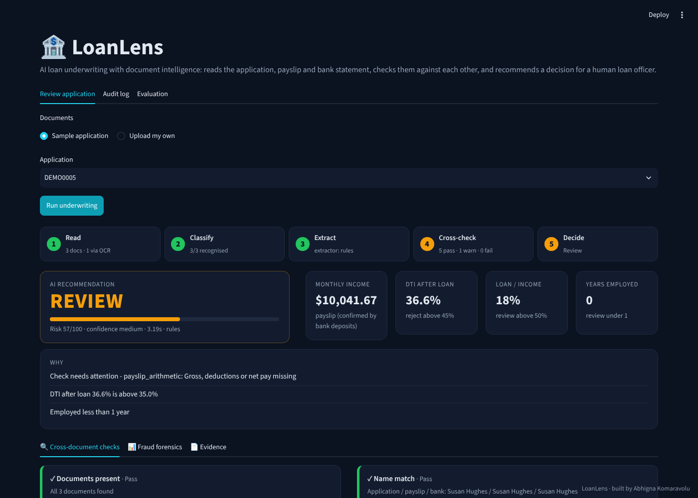
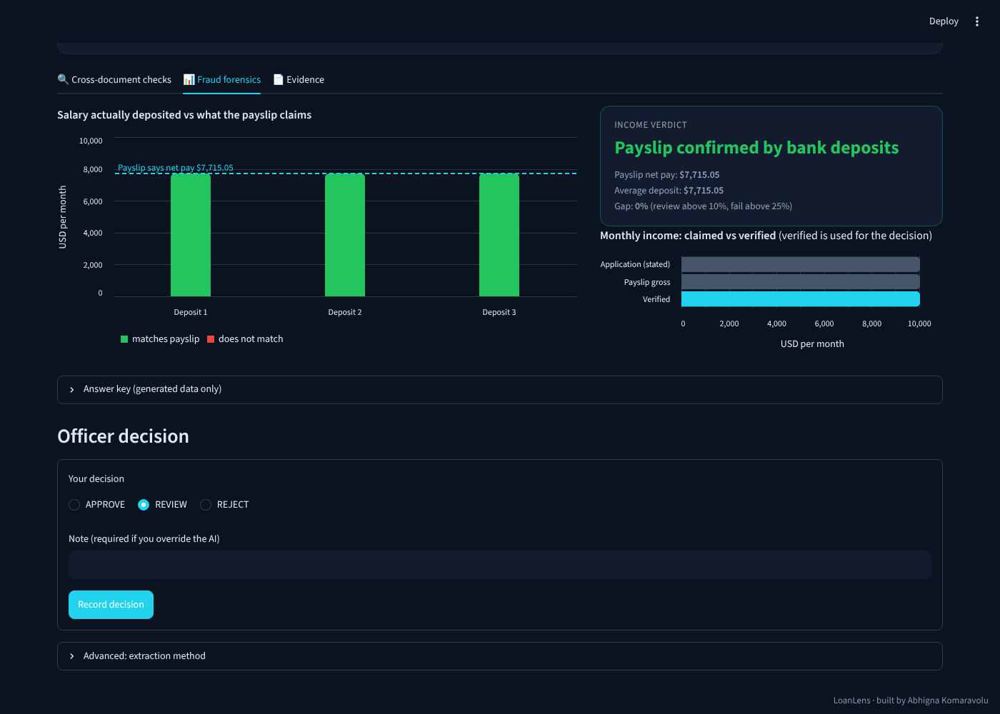
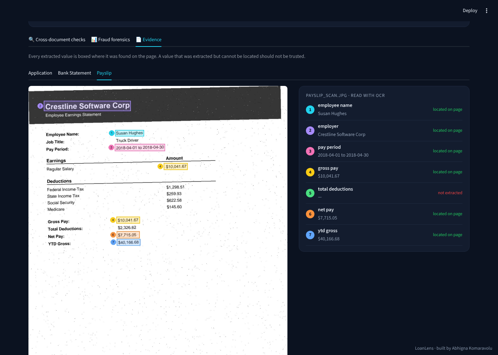
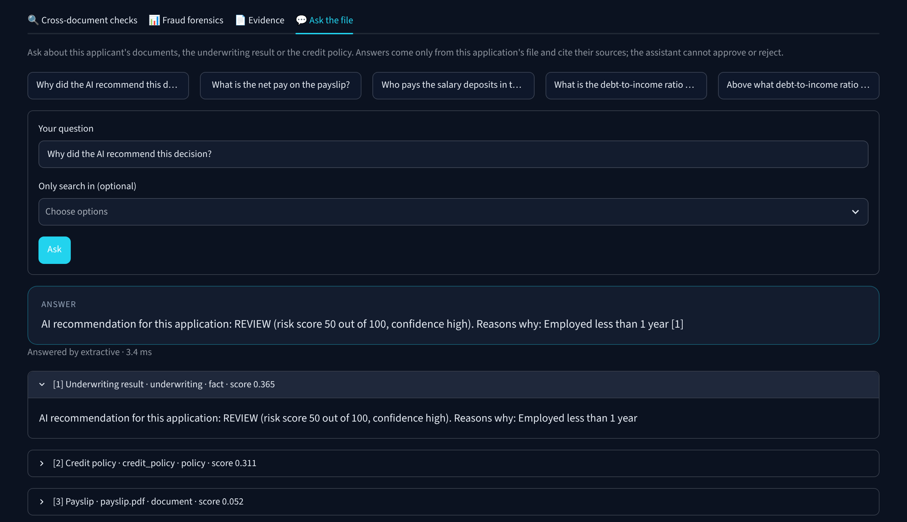
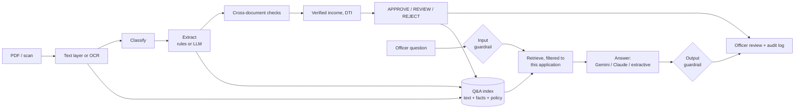

# LoanLens AI: Loan Underwriting with Document Intelligence and Cited Q&A


LoanLens reads a personal-loan applicant's **application form, payslip and bank statement**,
extracts the key fields, cross-checks the documents against each other to catch income fraud,
computes affordability and recommends **APPROVE / REVIEW / REJECT**, with written reasons, for
a human loan officer to confirm.

The officer can then **ask questions about the application file** ("What net pay does the
payslip show?", "Why was this sent to review?") and get short answers that **cite the exact
passage** they came from. Retrieval is filtered to one applicant, and guardrails check both the
question and the answer.



## What the officer sees

| Fraud forensics | Evidence highlighting |
|---|---|
|  |  |
| Salary actually deposited, month by month, against what the payslip claims. Inflated payslips stand out as red bars far below the claimed line. | Every extracted value is boxed and numbered where it was found on the page, so no number has to be trusted blindly. Values that were extracted but can't be located are flagged. |

**Ask the file:** answers cite numbered sources (document text, extracted facts, checks or the
credit policy), and each source can be expanded to show the passage.



## The problem

| | |
|---|---|
| **User** | Loan officer at a retail bank / NBFC |
| **Pain** | 30–60 min of manual document checking per application; inflated-income fraud slips through |
| **Outcome** | Faster decisions, fraud caught, lower defaults among approved loans, full audit trail |
| **AI's role** | Read unstructured documents and answer questions about them. Rules make money decisions. A human makes the final call. |

Full scope: [docs/SCOPE.md](docs/SCOPE.md) · Design: [docs/ARCHITECTURE.md](docs/ARCHITECTURE.md)

## How it works



**Underwriting checks**
- Same person on all documents
- Payslip arithmetic: gross − deductions = net
- Employer matches across application, payslip letterhead and payroll deposits
- Payslip income vs stated income
- **Payslip net pay vs salary actually deposited in the bank** (main fraud signal; when it fails,
  true income is re-estimated from deposits)

**Credit policy** (in `src/loanlens/config.py`): DTI after the new loan above 45% → reject,
above 35% → review; loan above 50% of annual income → review; under 1 year employed → review.

### Ask the file (retrieval-augmented generation)

| Step | What happens |
|---|---|
| **Index** | Each application becomes chunks of three kinds: raw **document** text (split at line boundaries, never mid-line), extracted **facts** (one per field, check and decision) and the **credit policy** (generated from `config.POLICY`, so it never drifts from the code). Every chunk carries `application_id`, `doc_type` and `kind` metadata. |
| **Retrieve** | TF-IDF over word and character n-grams (character n-grams handle OCR output like `NetAmountPayable`), plus a lending glossary for query expansion ("closing balance" also finds "Ending Balance"). Results are **filtered by metadata** to this application plus the shared policy. Two lanes always run: raw text and facts, so a field the extractor misread can still be answered from the document. |
| **Answer** | Gemini (same free key as extraction) or Claude when a key is set; otherwise an offline extractive answer built only from passage lines. If the LLM fails, the extractive answer is used. |
| **Input guardrail** | Blocks prompt injection, requests to approve / reject / change a decision, requests for SSNs or account numbers, and empty or oversized questions. |
| **Output guardrail** | Every answer must cite a passage that exists, and **every number in it must appear in the cited passages**. An LLM answer that fails is replaced by the extractive answer. Questions the file can't answer get "not found" instead of a guess. |

## Data: real numbers, generated documents

- **Real:** borrower income, existing debt (via DTI), loan amount, term, EMI and **actual
  repayment outcome** from the public [Lending Club dataset](https://www.kaggle.com/datasets/wordsforthewise/lending-club)
  (2007–2018). Sample: 1,000 repaid + 1,000 defaulted loans.
- **Generated:** the documents themselves, because real payslips and bank statements are
  private by law. Names and employers are fictional.
- **Stress tests built in:** 20% injected fraud (3 types), 25% scanned payslips, and 30% of
  documents in a **layout the regex rules have never seen**.

## Results

### Underwriting

Evaluated on **real Lending Club borrowers** (documents generated from their records; 23% with
injected fraud, 25% scanned payslips, 30% in a layout the regex rules have never seen).
The rules-vs-Gemini comparison uses the same 60 applications (17 of them fraudulent).

| Metric | Rules baseline | Gemini (free tier) |
|---|---|---|
| Field accuracy, seen layout | 99.5% | 97.3% |
| Field accuracy, **unseen layout** | **0.0%** | **97.2%** |
| Fraud recall | 88.2% | **100%** |
| Fraud precision | 55.6% | **100%** |
| False fraud alarms on clean applications | 12 | **0** |
| Risk score AUC vs real defaults | 0.522 | 0.629 |
| Seconds per application | 1.6 | 12.1 |

**Rules baseline on all 300 applications:** 100% document classification, 99.6% field accuracy
on the seen layout and 0% on the unseen one, 94.7% on scanned payslips, fraud recall 78.3%.
None of the 69 fraudulent applications was auto-approved: every missed case went to human
review.

### Ask the file

Golden set generated from each application's `truth.json` (the values actually printed on the
documents): 9 answerable questions about the file, 2 policy questions, 2 questions the file
cannot answer and 3 adversarial requests, for **40 demo applications (1,080 questions)**.
Offline extractive answers with the rules extractor, so this is a lower bound that runs in CI:

| Metric | Score |
|---|---|
| Retrieval hit@4 (expected document type retrieved) | 100% |
| Mean reciprocal rank | 0.989 |
| Answer accuracy (expected value in the answer) | 96.1% |
| Says "not found" when the file has no answer | 100% |
| Adversarial questions blocked | 100% |
| Passages leaked from another applicant's file | **0 of 1,729** |
| Average answer time | 4 ms |

The remaining misses are payslip questions where the rules extractor misread the document
(e.g. the employer read as "PAY SLIP") or OCR scrambled the reading order of a scan. Full
report: [evals/results/rag_extractive.md](evals/results/rag_extractive.md).

**What this shows**
- Template rules are fast and near-perfect on a known layout, but collapse on a new one, and
  their misreads (e.g. reading "PAY SLIP" as the employer) become false fraud alarms.
- The LLM extractor generalises to the unseen layout with no code changes and removed every
  false alarm, at about 8x the latency.
- Default prediction is modest (AUC 0.63). Lending Club had already approved these borrowers,
  and the documents carry only income, debt and employment, not credit history.
- Q&A retrieval stays inside one application by construction (metadata filter), and keeping a
  raw-text lane next to the extracted facts recovers values the extractor missed.

**Known weakness:** LLM accuracy on *scanned* payslips was about 75% (names, employer and pay
period copied with OCR spacing errors). The OCR cleanup used by the rules now runs on every
extractor's output; this has not been re-measured with Gemini yet. The Q&A numbers above use
offline answers; they have not been measured with Gemini or Claude answers yet.

Reproduce: `python evals/run_eval.py` (rules, all) ·
`python evals/run_eval.py --method gemini --limit 60 --sleep 7` ·
`python evals/run_rag_eval.py --limit 40` (Q&A)

## Quick start

### 1. Install (Windows PowerShell)
```powershell
git clone https://github.com/k-Abhigna/LoanLens-AI.git
cd LoanLens-AI
python -m venv .venv
.venv\Scripts\activate
pip install -r requirements.txt
pip install -e .
```
On Mac/Linux use `source .venv/bin/activate`. If PowerShell blocks activation, run
`Set-ExecutionPolicy -Scope CurrentUser RemoteSigned` once.

### 2. Try it on demo data (2 minutes, no downloads)
```powershell
python scripts/make_demo_data.py
python -m loanlens.generate.build_dataset --input data/demo/demo_borrowers.csv --limit 40
streamlit run app/streamlit_app.py
```
Pick an application, click **Run underwriting**, then open the **💬 Ask the file** tab.
Demo borrowers are random, so their "real outcome" numbers mean nothing. Use step 3 for real results.

### 3. Run on real Lending Club data
1. Download **Lending Club** by *wordsforthewise* from Kaggle and put
   `accepted_2007_to_2018Q4.csv.gz` in `data/raw/`.
2. Build the sample and documents, then evaluate:
```powershell
python scripts/make_sample.py
python -m loanlens.generate.build_dataset --limit 300
python evals/run_eval.py
```
Results are written to `evals/results/`.

### 4. Use an LLM (free)
Copy `.env.example` to `.env`, create a free key at https://aistudio.google.com/apikey and set
`GEMINI_API_KEY`. If the default model name is retired, set `GEMINI_MODEL` to a current free
model. The app uses Gemini for extraction and for Q&A answers; if it is unavailable (no key,
quota used up, timeout) it falls back to the offline rules / extractive answers and says so on
screen.

To answer questions with Claude instead, set `ANTHROPIC_API_KEY` (and leave `GEMINI_API_KEY`
empty, or set `LLM_PROVIDER=anthropic`).

```powershell
python evals/run_eval.py --method gemini --limit 100 --sleep 7
python -m loanlens.pipeline data/generated/<application_id> --method gemini
```
`--sleep` keeps you inside the free tier's rate limit (3 LLM calls per application).

### 5. REST API
```powershell
uvicorn api:app --reload     # docs at http://127.0.0.1:8000/docs
```
```bash
curl -X POST http://127.0.0.1:8000/applications -F "files=@application.pdf" -F "files=@payslip.pdf" -F "files=@bank_statement.pdf"
curl -X POST http://127.0.0.1:8000/applications/<application_id>/ask -H "Content-Type: application/json" -d '{"question": "What is the net pay on the payslip?"}'
```
`POST /applications/sample/<id>` underwrites one of the generated demo applications.

### 6. Tests
```powershell
pytest -q
```
CI runs the tests on Python 3.11–3.13, builds the demo set and runs the Q&A evaluation as a
quality gate (fails below 95% hit@4, 90% answer accuracy or 95% "not found" accuracy, any
unblocked adversarial question, or any cross-applicant leakage).

## Project structure

```
LoanLens-AI/
├── app/streamlit_app.py      # loan officer review UI, Ask-the-file tab, audit log, eval results
├── api.py                    # FastAPI: underwrite documents, ask questions
├── src/loanlens/
│   ├── generate/             # real borrower → documents, fraud injection, scans, layouts
│   ├── extract/              # OCR/PDF text, classifier, regex + LLM extractors
│   ├── rag/                  # Q&A: chunking, TF-IDF index, guardrails, answer providers
│   ├── checks.py             # cross-document verification
│   ├── decide.py             # credit policy engine
│   ├── pipeline.py           # end-to-end CLI
│   └── audit.py              # decision log
├── evals/
│   ├── run_eval.py           # extraction, fraud and real-outcome evaluation
│   └── run_rag_eval.py       # Q&A retrieval, answers, guardrails, leakage (CI gate)
├── scripts/                  # Lending Club sampling, demo data
├── tests/                    # pytest suite (runs in CI)
└── docs/                     # scope and architecture
```

## Design decisions

- **AI reads, code decides.** LLMs only convert documents into a validated schema and explain
  the file; lending decisions are deterministic, auditable rules.
- **Missing ≠ fraud.** An unreadable field sends the case to a human instead of flagging fraud.
  Evaluation showed the opposite design produced false fraud alarms.
- **Bank deposits are the anchor.** A payslip is easy to edit; salary actually received isn't.
- **One applicant per question.** Every chunk is tagged with its `application_id`; retrieval is
  filtered to it, and the evaluation counts any passage from another file as a failure.
- **Facts and raw text side by side.** Extracted facts give precise answers; the raw text lane
  still answers when extraction failed. Facts that say "not found" are down-weighted.
- **Answers must be checkable.** Every answer cites its passage, and numbers that aren't in the
  cited passages are rejected, so the assistant can't invent an income figure.
- **Human in the loop.** The officer confirms every decision; overrides need a written reason
  and are logged. The Q&A assistant refuses to approve or reject.

## Limitations & next steps

- Documents are US-format and generated; the next step is Indian formats (Form 16, salary slips
  with PF/ESI, Aadhaar/PAN KYC).
- Default prediction is limited because documents carry only income, debt and employment.
  Credit bureau data would be needed for a strong risk model.
- Retrieval is TF-IDF; dense embeddings with a vector database (and a reranker) are the next
  step if documents get longer or more varied.
- Q&A answers have been evaluated offline only; an LLM-answer run (Gemini / Claude) is next.
- Vision-LLM extraction directly from images (instead of OCR → LLM) is not yet compared.
- The rules-vs-LLM comparison covers 60 applications; a larger run would tighten the numbers.

## License
MIT
