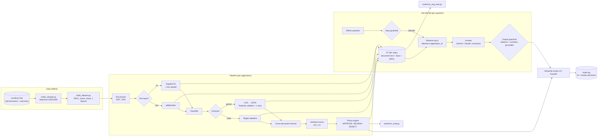

# Architecture

## Modules

| Module | Responsibility |
|---|---|
| `generate/profile.py` | Real borrower row → document facts; fraud injection |
| `generate/pdfs.py` | Render application form, payslip, bank statement (layouts A and B) |
| `generate/scan.py` | Turn a PDF into a noisy, tilted "phone scan" |
| `extract/text.py` | PDF text or OCR text with reading-order reconstruction |
| `extract/classify.py` | Document type from keywords |
| `extract/rules.py` | Regex extraction baseline, OCR-noise tolerant |
| `harness.py` | The one LLM gateway for extraction and Q&A: provider from config (Gemini / Claude / none), retries, `LLMUnavailable`, PII-free call traces, prompt versions |
| `extract/llm.py` | LLM JSON extraction through the harness, with schema validation and one retry |
| `extract/grounding.py` | Output guardrail: drops extracted values that do not appear in the document text |
| `checks.py` | Name, employer, arithmetic and income consistency checks; verified income |
| `decide.py` | Credit policy → decision, reasons, risk score, confidence |
| `audit.py` | Append-only log of AI recommendations and officer decisions |
| `pipeline.py` | Ties it all together; CLI |
| `rag/chunking.py` | Document text → line-safe chunks; extracted fields, checks and decision → fact chunks; credit policy → policy chunks. All tagged with `application_id`, `doc_type`, `kind` |
| `rag/index.py` | TF-IDF (word + char n-grams) index with metadata filtering, glossary query expansion and IDF weights |
| `rag/guardrails.py` | Input rules (injection, decision requests, sensitive data, length) and output rules (valid citations, grounded numbers) |
| `rag/llm.py` | Answer providers: Gemini, Claude, offline extractive; falls back to extractive on any failure |
| `rag/assistant.py` | `LoanKnowledgeBase`: ingest an application, two-lane retrieval, ask with guardrails |
| `api.py` | FastAPI: upload documents → decision; ask questions about an application |
| `evals/harbor/` | Harbor task suite (instruction, Dockerfile, verifier, oracle solution per application) and a Harbor agent that runs LoanLens |

## Key design decisions

1. **AI reads, code decides.** LLMs only turn unstructured documents into a fixed schema. All
   money decisions are deterministic rules a credit team can audit.
2. **Missing ≠ fraud.** If a field can't be read, the check is `warn` (human review), not
   `fail` (fraud). This was found through evaluation: treating missing values as mismatches
   produced false fraud alarms on clean applications.
3. **The bank statement is the anchor.** Payslips are easy to forge; salary actually deposited
   is harder. When the payslip disagrees with deposits, income is re-estimated from deposits.
4. **Evaluate on unseen layouts.** Regex rules score near 100% on the layout they were written
   for and fail on a new one. Layout B measures how each extractor generalises.
5. **Retrieval never crosses applicants.** Many applications share one index, but every
   chunk carries its `application_id` and every search is filtered to one application plus the
   shared credit policy. The Q&A evaluation counts leaked passages and CI fails on any.
6. **Two retrieval lanes.** Extracted facts are precise but can be wrong or missing (unseen
   layout, OCR); raw document text is noisy but complete. Half the top-k comes from each, and
   facts that say a value was "not found" are down-weighted, so the raw text can still answer.
7. **Grounded answers or none.** Every LLM answer must cite a real passage and every number in
   it must appear in the cited passages; otherwise it is replaced by an extractive answer made
   only of passage text. Unanswerable questions get "not found".
8. **Balanced outcomes.** The sample is 50% repaid / 50% defaulted, so "approve everyone" can't
   look good.
